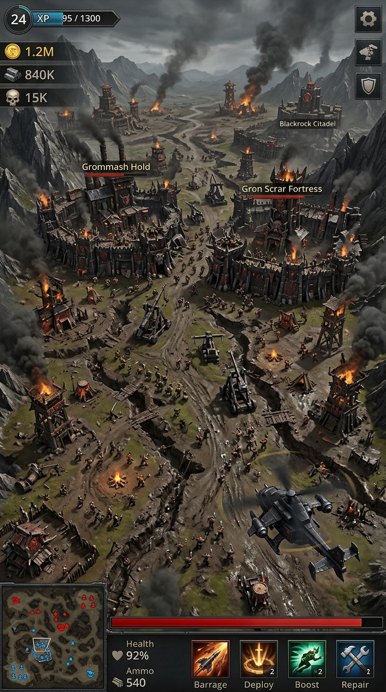

<p align="center">
  
</p>

<h1 align="center">HELICOPTER WAR: EMPIRE ENDLESS BATTLE</h1>

<p align="center">
  <strong>High-octane 3D vertical tactical helicopter warfare for Android</strong><br/>
  4 Enemy Empires &bull; 200 Fortified Barracks &bull; Multi-Phase Boss Fights &bull; Cloud Firestore Sync
</p>

<p align="center">
  <a href="https://github.com/gptgamestudio/hellwar-warzone/releases/latest/download/helicopter-war.apk"><strong>Direct APK Download (helicopter-war.apk)</strong></a> &bull;
  <a href="https://gptgamestudio.github.io/hellwar-warzone/"><strong>GitHub Pages Official Site</strong></a> &bull;
  <a href="https://hellwar-warzone.web.app/"><strong>Firebase Official Site</strong></a> &bull;
  <a href="https://github.com/gptgamestudio/hellwar-warzone/releases"><strong>GitHub Releases</strong></a> &bull;
  <a href="https://gptgamestudio.github.io/hellwar-warzone/privacy.html"><strong>Privacy Policy</strong></a>
</p>

---

## Official Android APK Download

> **Package ID:** `com.hellwar.game` &bull; **Minimum Android:** Android 7.0+ (API 24) &bull; **Target SDK:** Android 16 (API 36)

<!-- RELEASE_INFO_START -->
| Field | Details |
|---|---|
| **Direct APK Download** | **[Download `helicopter-war.apk` (Direct APK)](https://github.com/gptgamestudio/hellwar-warzone/releases/download/v1.0.4/helicopter-war.apk)** |
| **Latest Version** | `v1.0.4` |
| **APK File** | `helicopter-war.apk` (28.45 MB) |
| **Release Date** | `2026-11-26` |
| **Official Website (GitHub Pages)** | [gptgamestudio.github.io/hellwar-warzone](https://gptgamestudio.github.io/hellwar-warzone/) |
| **Official Website (Firebase)** | [hellwar-warzone.web.app](https://hellwar-warzone.web.app/) |
| **All Releases** | [View v1.0.4 Release Notes](https://github.com/gptgamestudio/hellwar-warzone/releases/tag/v1.0.4) |
<!-- RELEASE_INFO_END -->

### How Direct APK Releases Auto-Update
Whenever you push changes to `main` (e.g., via AI Studio **Push to GitHub**), push a `v*` tag, or trigger manual dispatch in GitHub Actions:
1. `.github/workflows/build-apk.yml` runs unit tests (`:app:testDebugUnitTest`) first, compiles, and verifies `helicopter-war.apk`.
2. Automatically publishes/updates `helicopter-war.apk` on GitHub Releases (`make_latest: true`), keeping the permanent Direct APK URL above always up to date.
3. Synchronizes `README.md`, `index.html`, `hosting/index.html`, `release-info.json`, `hosting/release-info.json`, and sitemaps on `main`, then auto-deploys GitHub Pages & Firebase Hosting.

---

## Release Highlights (`v1.0.4`)
- **Cloud-Authoritative Hangar & Non-Destructive Migration:** Server-side Cloud Functions (`functions/`) manage helicopter unlocks, upgrades, camo skins, and `creditsSpentCloud` inside the named enterprise Firestore DB, while safely migrating legacy Hangar state with backups and conflict quarantine.
- **AdMob ECDSA SSV & UMP Consent:** `RewardedAd` attaches `ServerSideVerificationOptions` verified on `admobSsvWebhook` with replay protection and server-enforced 10/24h continue quota; all ads strictly gate on UMP `canRequestAds()`.
- **Upgraded 3D Fleet Visuals, Combat Differentiation & Shield Mitigation:** Distinct 3D gunship silhouettes & active skin paint in Hangar and combat, class-specific autocannon fire rates / missile capacity / upgrade scaling, armor/shield damage mitigation, and live in-game Top 5 Global Leaderboard.
- **Privacy & Safe Logging:** Zero-PII `SafeLog` masks UIDs/emails/tokens and gates all Logcat output strictly behind `BuildConfig.DEBUG`.

---

## Four Empires Showcase & 200 Enemy Barracks

Battle across **4 distinct warzones**, each guarded by **50 unique fortified barracks (200 total)**, patrol aircraft, armored columns, and environmental hazards. Destroying all 50 barracks in an empire shatters its Headquarters forcefield and triggers an epic multi-phase Boss Battle:

| Empire Theater | Fortified Targets | Supreme Flagship Boss | Environmental Hazard |
|---|---|---|---|
| **Dragon Empire** | 50 Volcanic Barracks | *Ignis Rex: Dragon Emperor* | Erupting Lava Geysers |
| **Alien Empire** | 50 Plasma Pylon Barracks | *Overseer Prime: Alien Mothership* | Orbital Plasma Lightning |
| **Orc Empire** | 50 Ironclad Siege Barracks | *Warlord Gashrak: Sky Fortress* | Burning Smog Firepits |
| **Human Empire** | 50 Military Hangar Barracks | *Project Titan: Supreme Gunship* | EMP Defense Grids |

<p align="center">
  
  
  
  
</p>

---

## Gameplay Screenshots

<p align="center">
  
  
  
</p>

---

## Core Game Features
- **4 Playable Gunship Classes:** Unlock and pilot *Scout*, *Heavy Gunship*, *Stealth*, and *Ultimate War* helicopters with distinct armor, speed, shield, and ordnance specs.
- **5 Combat Upgrade Categories:** Upgrade Engine, Armor, Weapons, Defense Shields, and Radar/Tactical systems in the Hangar.
- **Precision Touch Controls:** Cross-shaped directional D-pad with banking roll physics, auto-firing twin 30mm autocannons, fan-spread Rocket Barrages, and Target-Lock Guided Missiles.
- **Google Sign-In & Cloud Firestore Sync:** Zero-trust Firebase backend (`hellwar-warzone`) persists pilot credits, high scores, and every destroyed barracks/headquarters victory across devices.
- **Rewarded Supply Airdrops:** Optional AdMob rewarded video drops grant `+1,000 CR` directly synced to Cloud Firestore.

---

## Android Installation Instructions
1. Tap **[Direct APK Download (`helicopter-war.apk`)](https://github.com/gptgamestudio/hellwar-warzone/releases/latest/download/helicopter-war.apk)** or open either official website ([GitHub Pages](https://gptgamestudio.github.io/hellwar-warzone/) / [Firebase Hosting](https://hellwar-warzone.web.app/)) on your Android phone.
2. Tap **Download `helicopter-war.apk` (Direct APK)** to start downloading the installer directly.
3. Open the downloaded `helicopter-war.apk` from your browser downloads or Android Files app.
4. If Android prompts *"For your security, your phone currently isn't allowed to install unknown apps"*, tap **Settings** &rarr; enable **Allow from this source** for your browser.
5. Tap **Install** and launch **Helicopter War** (`com.hellwar.game`).

---

## Security Rules & Owner-Only Access Policy
- **Project Owner Account Only (Backend & Admin):** Only the verified developer owner account (`gptgamestudio`) holds administrative access to Firebase backend (`hellwar-warzone`), Firestore Security Rules, signing keys, and GitHub Secrets. Players have **zero access** to backend configuration, database administration, or rules modification.
- **Strict Player Data Isolation (`request.auth.uid == userId`):** Global database access defaults to deny (`allow read, write: if false`). Authenticated Google Sign-In players can only `get`/update their **own** `users/{uid}` document and append-only battle ledgers; `list` across users, cross-player reads/writes, unauthenticated access, and deletions are strictly blocked in `firestore.rules`.
- **Full Policy:** See [`privacy.html`](privacy.html) / [Official Privacy & Security Policy](https://gptgamestudio.github.io/hellwar-warzone/privacy.html).

---

## GitHub Actions Secrets, Release Fingerprints & Search Console Setup

### 1. Mandatory GitHub Actions Release Secrets (No Keys Exposed in Source)
`.github/workflows/build-apk.yml` builds signed production APKs (`assembleRelease`) and **fails fast** if required release credentials are missing (`debug.keystore` fallback is strictly disabled). Configure these in **Repo Settings &rarr; Secrets and variables &rarr; Actions**:

- **Mandatory Production Signing Secrets:**
  - `RELEASE_KEYSTORE_BASE64`: Base64-encoded production release keystore (`my-upload-key.jks` containing key alias `upload`)
  - `STORE_PASSWORD`: Store password for the production release keystore
  - `KEY_PASSWORD`: Key password for the `upload` alias inside the production release keystore
- **Firebase Configuration Secret (Required if `app/google-services.json` is not present in workspace):**
  - `GOOGLE_SERVICES_JSON` *(or `GOOGLE_SERVICES_JSON_BASE64`)*: Raw or Base64-encoded `app/google-services.json` for `com.hellwar.game` (`hellwar-warzone`)
- **Optional CI Hosting Secret:**
  - `FIREBASE_SERVICE_ACCOUNT_HELLWAR_WARZONE`: Service account JSON key for automatic Firebase Hosting deploys (`deploy-firebase-hosting.yml`)

> **Security Note:** Never commit `*.jks`, `*.keystore`, `*.p12`, `*.pfx`, or `*keystore*.base64` files to Git. Keep all signing keys and passwords solely in GitHub Actions Secrets / AI Studio Secrets.

### 2. Firebase Release SHA-1 & SHA-256 Fingerprint Requirements
Production APKs signed with `RELEASE_KEYSTORE_BASE64` use a different certificate than the local debug keystore. Currently, `app/google-services.json` only registers the debug SHA-1 fingerprint (`2ae4319cf426595dca272bf5fb15b0db007afd8d`). For **Google Sign-In (`CredentialManager`)** and **Firebase Authentication** to succeed on release builds:
1. Extract your upload keystore's **SHA-1** and **SHA-256** fingerprints locally:
   ```bash
   keytool -list -v -keystore my-upload-key.jks -alias upload
   ```
2. Open **Firebase Console &rarr; Project Settings (`hellwar-warzone`) &rarr; Your apps &rarr; `com.hellwar.game` (Android)** and add both the **Release SHA-1** and **Release SHA-256** fingerprints.
3. Download the updated `google-services.json` and update `app/google-services.json` (and your `GOOGLE_SERVICES_JSON` / `GOOGLE_SERVICES_JSON_BASE64` secret if used).

### 3. Google Search Console Verification
1. Open [Google Search Console](https://search.google.com/search-console) &rarr; **Add Property** &rarr; **URL prefix**: `https://gptgamestudio.github.io/hellwar-warzone/`.
2. Choose **HTML tag** verification, copy the `content="..."` token, and replace `YOUR_GOOGLE_SEARCH_CONSOLE_TOKEN` inside `index.html` (line with `google-site-verification`).
3. Push to GitHub, wait ~1 minute for GitHub Pages deployment, tap **Verify** in Search Console, then open **Sitemaps** and submit `sitemap.xml`.
