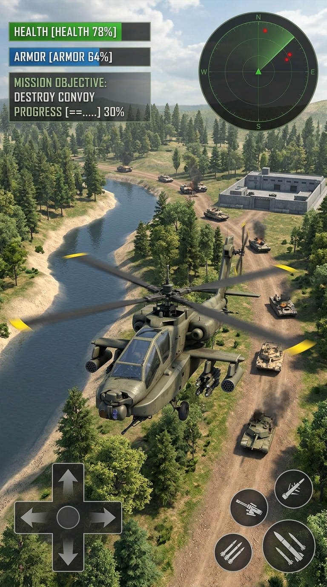
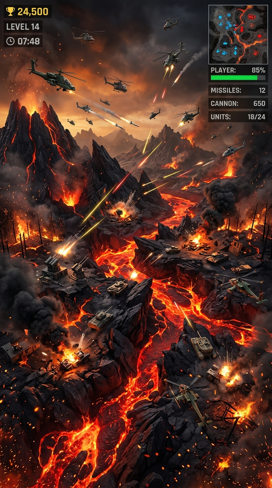
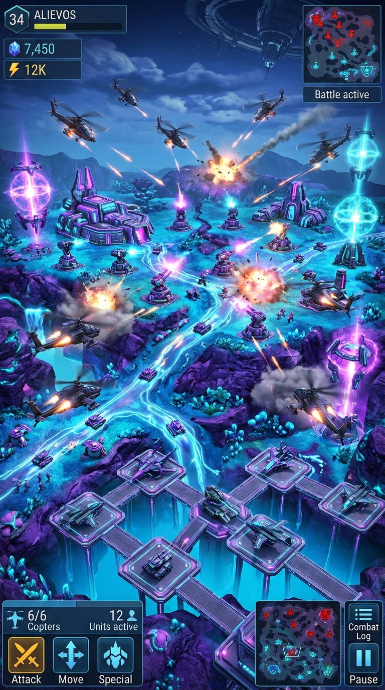
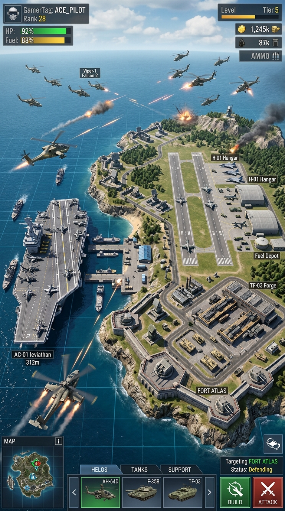
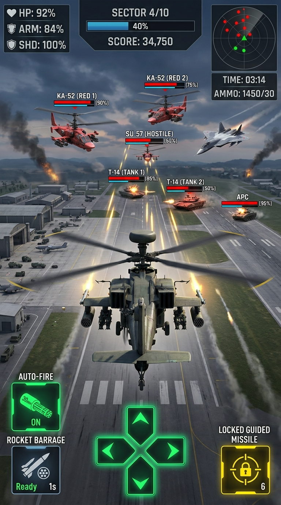
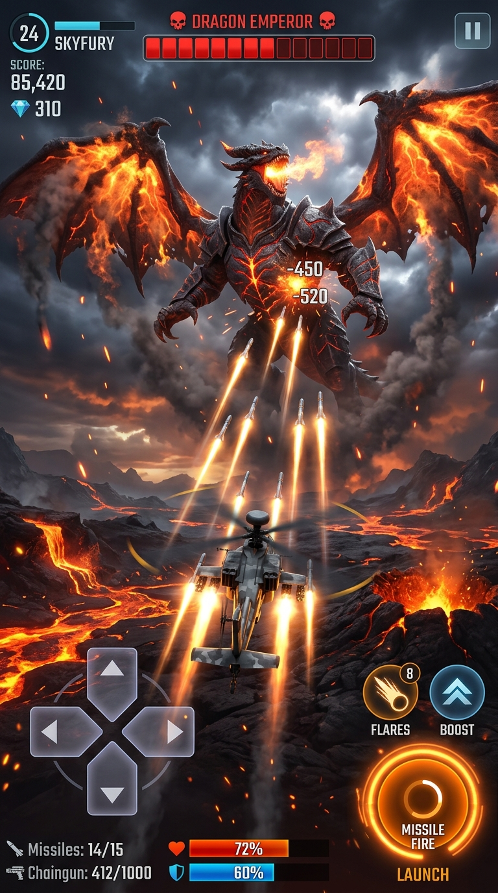
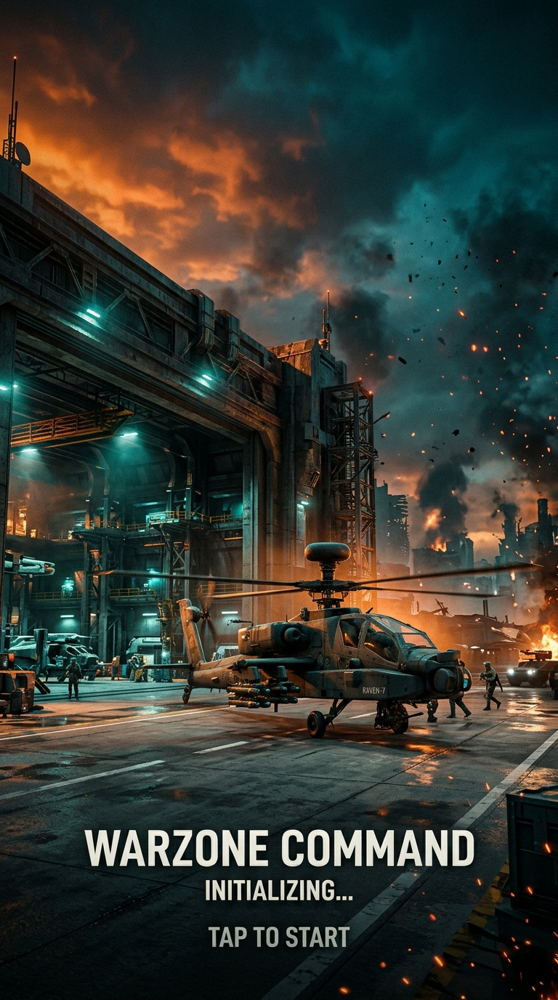

  

<h1 align="center">HELICOPTER WAR: EMPIRE ENDLESS BATTLE</h1>

  <strong>High-octane 3D vertical tactical helicopter warfare for Android</strong> 
  4 Enemy Empires &bull; 200 Fortified Barracks &bull; Multi-Phase Boss Fights &bull; Cloud Firestore Sync

  <a href="https://github.com/gptgamestudio/hellwar-warzone/releases/latest/download/helicopter-war.apk"><strong>Direct APK Download (helicopter-war.apk)</strong></a> &bull;
  <a href="https://gptgamestudio.github.io/hellwar-warzone/"><strong>GitHub Pages Official Site</strong></a> &bull;
  <a href="https://hellwar-warzone.web.app/"><strong>Firebase Official Site</strong></a> &bull;
  <a href="https://github.com/gptgamestudio/hellwar-warzone/releases"><strong>GitHub Releases</strong></a> &bull;
  <a href="https://gptgamestudio.github.io/hellwar-warzone/privacy.html"><strong>Privacy Policy</strong></a>

---

## Official Android APK Download

> **Package ID:** `com.hellwar.game` &bull; **Minimum Android:** Android 7.0+ (API 24) &bull; **Target SDK:** Android 16 (API 36)

<!-- RELEASE_INFO_START -->
| Field | Details |
|---|---|
| **Direct APK Download** | **[Download `helicopter-war.apk` (Direct APK)](https://github.com/gptgamestudio/hellwar-warzone/releases/latest/download/helicopter-war.apk)** |
| **Latest Version** | `v1.0.2` (`versionCode 3`) |
| **APK File** | `helicopter-war.apk` (`35.21 MB`) |
| **Official Website (GitHub Pages)** | [gptgamestudio.github.io/hellwar-warzone](https://gptgamestudio.github.io/hellwar-warzone/) |
| **Official Website (Firebase)** | [hellwar-warzone.web.app](https://hellwar-warzone.web.app/) |
| **All Releases** | [View GitHub Releases](https://github.com/gptgamestudio/hellwar-warzone/releases) |
<!-- RELEASE_INFO_END -->

### How Direct APK Releases Auto-Update
Whenever you push changes to `main` (e.g., via AI Studio **Push to GitHub**), push a `v*` tag, or trigger manual dispatch in GitHub Actions:
1. `.github/workflows/build-apk.yml` compiles, runs all unit tests, and verifies `helicopter-war.apk`.
2. Automatically publishes/updates `helicopter-war.apk` on GitHub Releases (`make_latest: true`), keeping the permanent Direct APK URL above always up to date.
3. Synchronizes `README.md`, `index.html`, `hosting/index.html`, `release-info.json`, `hosting/release-info.json`, and sitemaps, then auto-deploys GitHub Pages & Firebase Hosting.

---

## Release Highlights (`v1.0.2`)
- **Pro Campaign & Boss Combat System:** 5 Main Hearts (10 hits per heart), 24h cap of 10 Rewarded Ad continues (+5 Hearts), Interstitial continues, strict sequential Empire unlock (50 Barracks per Empire &rarr; Danger Zone Boss 100 hits &rarr; HQ 1,000 hits), Countermeasure Flare, Overdrive Plasma Cannon, and Hangar checkpoint resume (`CONTINUE STAGE`).
- **CI/CD & Google Sign-In Resilience:** Hardened JDK 21 / Android SDK workflow, dynamic `default_web_client_id` resolution, automated keystore materialization, and chained GitHub Pages deployment.
- **Official Websites & Direct APK Delivery:** Mobile-responsive download portals on GitHub Pages (`gptgamestudio.github.io/hellwar-warzone`) and Firebase Hosting (`hellwar-warzone.web.app`) pointing directly to `helicopter-war.apk`.

---

## Four Empires Showcase & 200 Enemy Barracks

Battle across **4 distinct warzones**, each guarded by **50 unique fortified barracks (200 total)**, patrol aircraft, armored columns, and environmental hazards. Destroying all 50 barracks in an empire shatters its Headquarters forcefield and triggers an epic multi-phase Boss Battle:

| Empire Theater | Fortified Targets | Supreme Flagship Boss | Environmental Hazard |
|---|---|---|---|
| **Dragon Empire** | 50 Volcanic Barracks | *Ignis Rex: Dragon Emperor* | Erupting Lava Geysers |
| **Alien Empire** | 50 Plasma Pylon Barracks | *Overseer Prime: Alien Mothership* | Orbital Plasma Lightning |
| **Orc Empire** | 50 Ironclad Siege Barracks | *Warlord Gashrak: Sky Fortress* | Burning Smog Firepits |
| **Human Empire** | 50 Military Hangar Barracks | *Project Titan: Supreme Gunship* | EMP Defense Grids |

  
  
  
  

---

## Gameplay Screenshots

  
  
  

---

## Core Game Features
- **4 Playable Gunship Classes:** Unlock and pilot *Scout*, *Heavy Gunship*, *Stealth*, and *Ultimate War* helicopters with distinct armor, speed, shield, and ordnance specs.
- **5 Combat Upgrade Categories:** Upgrade Engine, Armor, Weapons, Defense Shields, and Radar/Tactical systems in the Hangar.
- **Precision Touch Controls:** Cross-shaped directional D-pad with banking roll physics, auto-firing twin 30mm autocannons, fan-spread Rocket Barrages, and Target-Lock Guided Missiles.
- **Google Sign-In & Cloud Firestore Sync:** Zero-trust Firebase backend (`hellwar-warzone`) persists pilot credits, high scores, and every destroyed barracks/headquarters victory across devices.
- **Rewarded Supply Airdrops:** Optional AdMob rewarded video drops grant `+1,000 CR` directly synced to Cloud Firestore.

---

## Android Installation Instructions
1. Tap **[Direct APK Download (`helicopter-war.apk`)](https://github.com/gptgamestudio/hellwar-warzone/releases/latest/download/helicopter-war.apk)** or open either official website ([GitHub Pages](https://gptgamestudio.github.io/hellwar-warzone/) / [Firebase Hosting](https://hellwar-warzone.web.app/)) on your Android phone.
2. Tap **Download `helicopter-war.apk` (Direct APK)** to start downloading the installer directly.
3. Open the downloaded `helicopter-war.apk` from your browser downloads or Android Files app.
4. If Android prompts *"For your security, your phone currently isn't allowed to install unknown apps"*, tap **Settings** &rarr; enable **Allow from this source** for your browser.
5. Tap **Install** and launch **Helicopter War** (`com.hellwar.game`).

---

## Security Rules & Owner-Only Access Policy
- **Project Owner Account Only (Backend & Admin):** Only the verified developer owner account (`gptgamestudio`) holds administrative access to Firebase backend (`hellwar-warzone`), Firestore Security Rules, signing keys, and GitHub Secrets. Players have **zero access** to backend configuration, database administration, or rules modification.
- **Strict Player Data Isolation (`request.auth.uid == userId`):** Global database access defaults to deny (`allow read, write: if false`). Authenticated Google Sign-In players can only `get`/update their **own** `users/{uid}` document and append-only battle ledgers; `list` across users, cross-player reads/writes, unauthenticated access, and deletions are strictly blocked in `firestore.rules`.
- **Full Policy:** See [`privacy.html`](privacy.html) / [Official Privacy & Security Policy](https://gptgamestudio.github.io/hellwar-warzone/privacy.html).

---

## GitHub Actions Secrets & Google Search Console Setup

### 1. Optional CI Secrets (No Keys Exposed in Source)
To enable full Google Sign-In + Firebase Firestore in CI-built APKs and Firebase Hosting auto-deploy, add these in **Repo Settings &rarr; Secrets and variables &rarr; Actions**:
- `GOOGLE_SERVICES_JSON`: Contents of your `app/google-services.json`
- `DEBUG_KEYSTORE_BASE64`: Contents of `debug.keystore.base64` (keeps SHA-1 matching Firebase Android OAuth)
- `FIREBASE_SERVICE_ACCOUNT_HELLWAR_WARZONE`: Optional JSON key for Firebase Hosting auto-deploy

### 2. Google Search Console Verification
1. Open [Google Search Console](https://search.google.com/search-console) &rarr; **Add Property** &rarr; **URL prefix**: `https://gptgamestudio.github.io/hellwar-warzone/`.
2. Choose **HTML tag** verification, copy the `content="..."` token, and replace `YOUR_GOOGLE_SEARCH_CONSOLE_TOKEN` inside `index.html` (line with `google-site-verification`).
3. Push to GitHub, wait ~1 minute for GitHub Pages deployment, tap **Verify** in Search Console, then open **Sitemaps** and submit `sitemap.xml`.
